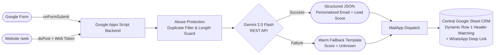

# AI Lead Automation System — Anantam Career Academy
**Yuga PMC Round 1 Evaluation** · Google Apps Script · Gemini 2.0 Flash · Multi-Channel Lead Engine

---

## 📌 Project Overview
Anantam Career Academy is a premier career upskilling institute offering high-impact programs in **Full Stack Web Development, Data Science Pro, DSA Bootcamp, CAT/MBA Prep, and UPSC Foundation**. 

This repository houses an end-to-end, zero-server AI lead automation engine built to eliminate counselor response delays. Inquiries arriving via **Google Forms** or the **Web Portal (`/web`)** trigger automated intent classification, lead scoring (`Hot`, `Warm`, `Cold`), and immediate personalized outreach emails (<120 words) powered by **Google Gemini 2.0 Flash**, complete with pre-filled WhatsApp Click-to-Chat shortcuts.

---

## 🏗️ System Architecture Flow



---

## 📁 Repository Structure

```
.
├── src/
│   └── Code.gs              # Unified Google Apps Script engine (Form & Web intake, Gemini call, Sheet sync)
├── docs/
│   ├── setup.md             # Complete step-by-step setup guide with exact menu names & troubleshooting
│   ├── deploy_website.md    # Guide for deploying the Web App, script properties & Netlify/GitHub Pages
│   ├── demo_script.md       # 3-minute presentation script with timed cues for evaluation
│   ├── one_page_note.md     # Executive summary covering tools, automation logic & 30-day plan
│   ├── architecture.md      # Detailed system architecture & module breakdowns
│   └── technical-note.md    # Technical note on design decisions & security considerations
├── tests/
│   ├── test_leads.md        # Comprehensive test scenarios (Hinglish, angry, bad token, duplicates, etc.)
│   ├── test-cases.md        # Formal test matrix (TC-01 through TC-10)
│   └── sample-event.json    # Canonical mock event payload for manual testing
├── web/
│   ├── index.html           # Accessible, semantic SPA (Capture Lead, Sheet, Dashboard, Setup)
│   ├── style.css            # Responsive CSS with Light & Dark mode, pure CSS bar charts
│   ├── app.js               # Vanilla JS controller (Mock mode, search, filter, WhatsApp normaliser)
│   └── config.example.js    # Configuration template for Web App URL & token
├── .gitignore               # Excludes environment config and temporary files
└── README.md                # Project documentation
```

---

## ✨ Key Features & Capabilities

1. **Dual Intake Channels:**
   - **Google Forms:** Native `onFormSubmit` event trigger.
   - **Custom Web Portal (`/web`):** Vanilla HTML/CSS/JS single-page application with dark mode, live search, and dashboard.
2. **AI Intent Classification & Scoring:**
   - Evaluates incoming message intent into `Hot 🔥`, `Warm ⚡`, or `Cold ❄️` tiers in the same single API call.
3. **Strict Safety & Quality Guardrails:**
   - Tone is encouraging and professional English (gracefully handles Hinglish and angry queries).
   - Enforces negative constraints: zero hallucinated course fees, no fake job guarantees, strictly under 120 words.
4. **Resilient Fallback Engine:**
   - If the Gemini API experiences network timeouts or rate limits, the system catches the error and immediately dispatches a warm fallback template. Zero leads are left stranded.
5. **Dynamic Column Mapping:**
   - Google Sheet columns are matched dynamically by header name on Row 1 (schema-independent).
6. **Multi-Channel Dispatch:**
   - Automated email dispatch via `MailApp`.
   - Automatic phone normalisation (`+91`) creating one-click WhatsApp Click-to-Chat links.
7. **Production Abuse Protection:**
   - Rejects messages over 1,000 characters.
   - Suppresses duplicate submissions from the same email within 5 minutes.
   - Concurrency locking with `LockService` for safe simultaneous row writes.

---

## 🔒 Security Architecture
- **Zero Secrets in Client Code:** The Gemini API key stays server-side in Google Apps Script `PropertiesService.getScriptProperties()` (`GEMINI_KEY`).
- **Scoped Website Token:** The website authenticates using a scoped, throwaway token (`WEB_TOKEN`) with no administrative privileges.

---

## 🚀 Quick Start Guide

### 1. Backend Setup
1. Create a Google Form and link it to a Google Sheet.
2. In the Sheet, go to **Extensions $\rightarrow$ Apps Script** and paste `src/Code.gs`.
3. In **Project Settings (⚙) $\rightarrow$ Script Properties**, add:
   - `GEMINI_KEY`: Your Gemini API key from [Google AI Studio](https://aistudio.google.com).
   - `WEB_TOKEN`: A secret passphrase (e.g., `anantam_web_secure_token_2026`).
4. Click **Deploy $\rightarrow$ New deployment $\rightarrow$ Web app** (Execute as: *Me*, Who has access: *Anyone*).
5. Copy the `/exec` URL.

### 2. Local Web Portal
1. Open the `/web` directory in your browser or run:
   ```bash
   python -m http.server 8000 --directory web
   ```
2. Navigate to `http://localhost:8000`. By default, it operates in **Mock Mode** for local testing without needing credentials.
3. To connect live, copy `web/config.example.js` to `web/config.js`, paste your Web App URL, set `MOCK: false`, and refresh.

---

*Built for Yuga PMC Round 1 Evaluation · Anantam Career Academy*
