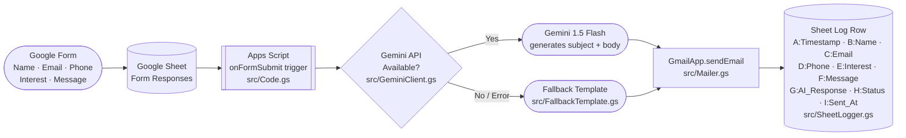
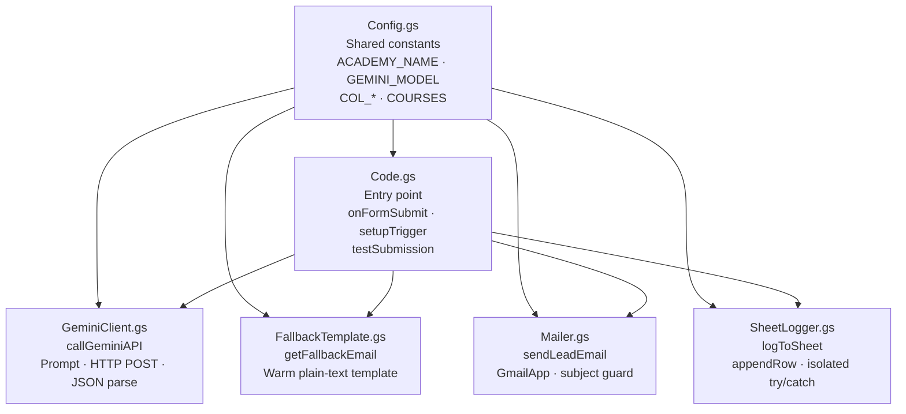

# Architecture — Anantam Career Academy AI Lead Automation

## System Flow Diagram

---

## Module Responsibilities

---

## Data Flow Narrative

### Happy Path (AI available)
1. Lead submits Google Form → Sheet records the response row
2. `onFormSubmit(e)` fires via the installed trigger
3. Five fields extracted from `e.namedValues`: Name, Email, Phone, Interest, Message
4. `callGeminiAPI()` builds a prompt, POSTs to `gemini-1.5-flash`, receives personalised email text
5. Subject extracted from line 1 of the AI response; body from remaining lines
6. `sendLeadEmail()` dispatches the email via `GmailApp.sendEmail()`
7. `logToSheet()` appends a 9-column audit row; status = `Sent-AI`

### Fallback Path (AI fails)
3–4. `callGeminiAPI()` throws (bad key · HTTP error · empty response · network timeout)
5. `getFallbackEmail()` returns a warm, name-and-interest-personalised plain-text template
6–7. Same send + log flow; status = `Sent-Fallback`, AI_Response = `FALLBACK — AI error: <message>`

### Emergency Path (unexpected crash)
- If anything breaks before the email send, the outer `catch` in `onFormSubmit` attempts one final fallback email using `"your chosen course"` as the interest placeholder.

---

## Security Architecture

| Component | Mechanism |
|---|---|
| API key | `PropertiesService.getScriptProperties()` — server-side only, never in source |
| Email auth | `GmailApp` uses OAuth of the script owner's Google account; no SMTP credentials |
| PII storage | Sheet (name, email, phone) — access controlled by Google Drive sharing settings |
| Trigger ownership | Runs under the account that executed `setupTrigger()`; deactivated only if that account is deleted |

---

*Part of the Yuga PMC Round 1 · Anantam Career Academy AI Lead Automation project*
