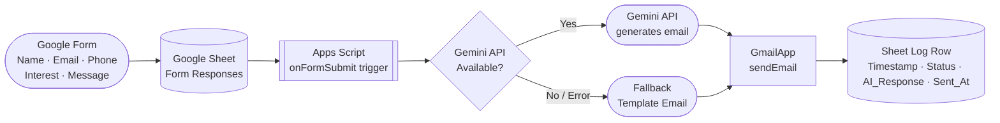

# AI Lead Automation — Technical Note
**Anantam Career Academy** · Google Apps Script + Gemini AI · v1.0

---

## 1. Project Overview

Anantam Career Academy's AI Lead Automation system converts every Google Form enquiry into a personalised outreach email — fully automatically, with zero human intervention. When a prospect submits the form, an Apps Script trigger fires, calls the Gemini API to draft a warm, context-aware email, and dispatches it via Gmail, logging every transaction back to the same Google Sheet. The system requires no server, no deployment pipeline, and no additional infrastructure beyond the Google Workspace tools the academy already uses.

---

## 2. Architecture Diagram

---

## 3. Key Design Decisions

- **Apps Script only — no external server.**  
  The entire automation lives inside Google's ecosystem. There is nothing to host, nothing to scale, and nothing to maintain. The academy's Google account is the deployment environment.

- **Gemini API for email generation.**  
  Gemini produces fluent, context-sensitive prose that references the lead's specific interest and message. This yields emails that feel genuinely personal rather than template-stamped, improving reply rates and first impressions.

- **PropertiesService for the API key.**  
  The Gemini key is stored in Script Properties (server-side), never hard-coded in source. It is invisible to Sheet editors and cannot be accidentally shared if the script file is copied or exported.

- **Graceful fallback template.**  
  If the Gemini call fails (network error, quota exceeded, invalid key), the system falls back to a carefully written plain-text template that still uses the lead's name and stated interest. No enquiry is ever left unanswered.

- **Sheet as the audit log.**  
  Appending a row (Timestamp, Name, Email, Phone, Interest, Message, AI_Response, Status, Sent_At) after every send gives the academy a full, human-readable audit trail — no separate database, no dashboard — right next to the form responses.

---

## 4. Setup Instructions

1. **Create the Google Form** with five fields in this order: Name, Email, Phone, Interest, Message.
2. **Link a Google Sheet** via Form → Responses → Link to Sheets. This becomes both the response store and the log.
3. **Open the Script Editor** from the Sheet: Extensions → Apps Script.
4. **Paste the script** (`Code.gs`) and save. The file contains `onFormSubmit`, `callGeminiAPI`, `sendLeadEmail`, `logToSheet`, `getFallbackEmail`, `setupTrigger`, and `testSubmission`.
5. **Set the API key**: in Apps Script, go to Project Settings → Script Properties → Add property `GEMINI_API_KEY` with your Gemini API key value.
6. **Run `setupTrigger()`** once from the editor (Run menu). This installs the `onFormSubmit` event trigger on the linked spreadsheet.
7. **Authorize permissions** when prompted: the script needs access to Gmail, Sheets, and UrlFetchApp (external HTTP). Review and approve.
8. **Test with `testSubmission()`**: run this function from the editor to simulate a fake form submission. Verify the email arrives and a log row appears in the Sheet.

---

## 5. Security & Privacy Considerations

| Concern | Mitigation |
|---|---|
| API key exposure | Stored in PropertiesService; never in source code or Sheet cells |
| PII in the Sheet | Form responses and log rows contain name, email, phone — restrict Sheet access to authorised staff only via Google Drive sharing settings |
| Email spoofing | Emails are sent from the authenticated Google account running the script; no external SMTP credentials required |
| Trigger ownership | The trigger runs under the account that executed `setupTrigger()`; rotating that account's password does not invalidate it, but deleting the account does |
| Data retention | The Sheet accumulates all lead data indefinitely; the academy should define a data-retention policy and periodically archive or delete old rows |

---

## 6. Limitations & Future Enhancements

**Current limitations**
- Gemini API has a free-tier rate limit; high form-submission bursts may hit quota and fall back to the template.
- The script runs synchronously within Apps Script's 6-minute execution limit; extremely long Gemini responses could time out.
- No deduplication: if the same email submits the form twice, two emails will be sent.
- Logging is append-only; there is no built-in mechanism to flag or suppress duplicate sends.

**Potential future enhancements**
- **CRM integration** (e.g., Zoho Bigin, HubSpot) — push each lead row via API for a full pipeline view.
- **Multi-step follow-up** — use time-based triggers to send a second email 48 hours later if no reply is detected.
- **Admin dashboard** — a Google Looker Studio report atop the Sheet for real-time lead and email-status metrics.
- **Duplicate guard** — check existing Sheet emails before sending to prevent repeat outreach.
- **WhatsApp / SMS channel** — extend `sendLeadEmail` to also call a Twilio or WATI webhook for instant messaging outreach.

---

*Document prepared for Yuga PMC Round 1 evaluation · Anantam Career Academy AI Lead Automation Project*
