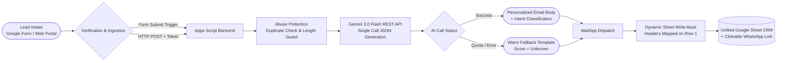
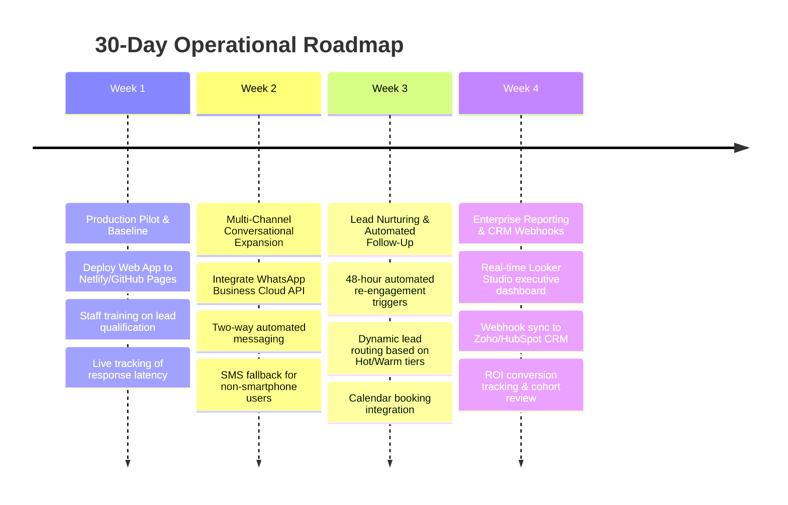

# Executive Project Brief: AI Lead Automation System
**Anantam Career Academy · Yuga PMC Round 1 Evaluation**

---

## 1. Chosen Work Domain: Professional EdTech & Career Upskilling

* **Organization:** Anantam Career Academy *(fictional premier coaching institute)*.
* **Core Offerings:** Full Stack Web Development, Data Science Pro, DSA Bootcamp, CAT/MBA Prep, UPSC Foundation.
* **The Business Problem:** Prospective students submitting course inquiries expect prompt, relevant answers regarding placements, eligibility, batch schedules, and fees. Traditional manual counseling leads to 4–12 hour response delays, inconsistent qualification, and high drop-off rates.
* **The Solution:** A zero-server, multi-channel automated intake system that analyzes prospective student intent in real time, scores lead urgency (`Hot`, `Warm`, `Cold`), generates tailored personalized outreach emails (<120 words), creates instant WhatsApp click-to-chat links, and synchronizes all data into a unified CRM spreadsheet.

---

## 2. Tools & Technology Stack

| Layer | Technology | Role & Justification |
|---|---|---|
| **Intake Channels** | **Google Forms** & **Vanilla HTML/CSS/JS** | Dual-channel capture: embedded Google Form and custom website portal (`/web`). No client-side frameworks or build steps required. |
| **Backend & Compute** | **Google Apps Script** (`onFormSubmit` & `doPost`) | Serverless execution hosted inside Google Cloud. Zero infrastructure cost, native authentication, and high reliability. |
| **Generative Intelligence** | **Google Gemini 2.0 Flash REST API** | Sub-second latency language model producing structured JSON containing personalized responses and lead scoring in a single round-trip. |
| **Delivery Channels** | **Google Workspace MailApp** & **WhatsApp Deep Links** | Instant automated email dispatch plus pre-filled, phone-normalized (`+91`) WhatsApp Click-to-Chat shortcuts. |
| **Database & Audit CRM** | **Google Sheets** (Dynamic Column Mapping) | Single source of truth. Columns are discovered by header name rather than hard-coded letters, supporting dynamic schema evolution. |
| **Security & Secrets** | **PropertiesService (Script Properties)** | Server-side vault for `GEMINI_KEY` and `WEB_TOKEN`. Zero secrets or credentials exposed to the client or repository. |

---

## 3. How the Automation Works

1. **Multi-Channel Capture:** Inquiries arrive either via Google Form submission (`onFormSubmit`) or the Web Portal (`doPost` with `WEB_TOKEN`).
2. **Abuse Protection & Concurrency:** Requests pass through length validation (<1,000 chars), email format checks, a 5-minute duplicate suppression filter, and `LockService` thread locking.
3. **Structured Dual AI Output:** A single prompt sends lead details to `gemini-2.0-flash`, enforcing strict guardrails (no invented fees or fake guarantees, <120 words, first-name greeting, single call-to-action). It returns structured JSON: `{ "email": "...", "lead_score": "Hot|Warm|Cold" }`.
4. **Resilient Fallback:** If the external API times out or rate limits, the system catches the exception and immediately transmits a personalized fallback template. No student inquiry is lost.
5. **Dynamic Sheet Synchronization:** The script reads Row 1 headers to dynamically determine target columns (`Time`, `Name`, `Email`, `Interest`, `Score`, `Status`, `Source`, etc.), auto-creating any missing columns.

---

## 4. 30-Day Implementation & Growth Roadmap

* **Week 1 (Production Pilot & Calibration):**
  - Connect custom domain and deploy `/web` via Netlify or GitHub Pages.
  - Run pilot with the admissions team; calibrate prompt tone and intent scoring using initial 50 real student inquiries.
  - Track response delivery latency (target: <15 seconds from submission to delivery).
* **Week 2 (Multi-Channel Expansion):**
  - Upgrade WhatsApp deep links to automated two-way WhatsApp Business Cloud API webhooks.
  - Implement SMS fallback notifications for applicants with intermittent data access.
* **Week 3 (Intelligent Nurturing & Routing):**
  - Implement a time-driven trigger (`ScriptApp.newTrigger`) to execute an automated 48-hour follow-up sequence for unengaged leads.
  - Add auto-routing: immediately notify senior admissions counselors via email/Slack when a `Hot` lead registers.
  - Embed direct Google Calendar / Cal.com booking links in the AI outreach body.
* **Week 4 (Analytics & Enterprise Integration):**
  - Build a live Google Looker Studio dashboard connected directly to the Sheet to track lead-to-enrollment conversion rates.
  - Establish outbound webhook synchronization to upstream CRMs (e.g., HubSpot, Zoho Bigin, Salesforce).
  - Conduct full performance audit and security key rotation.

---

*Prepared for Yuga PMC Round 1 Evaluation · Anantam Career Academy Lead Automation Architecture*
